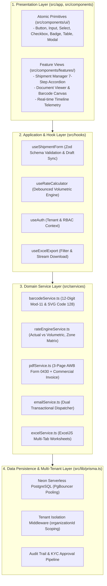
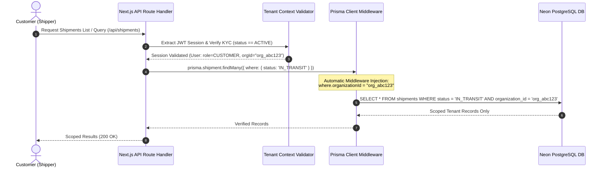
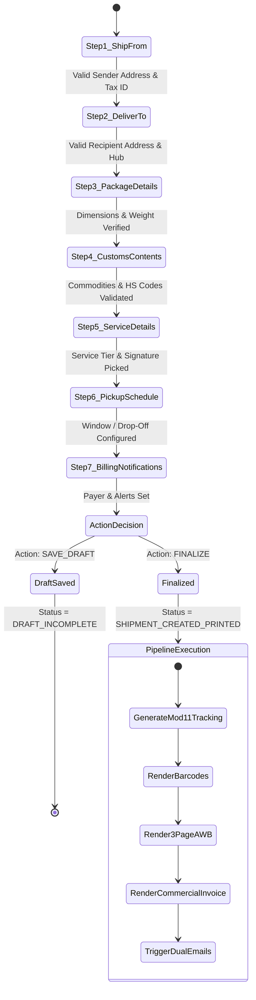
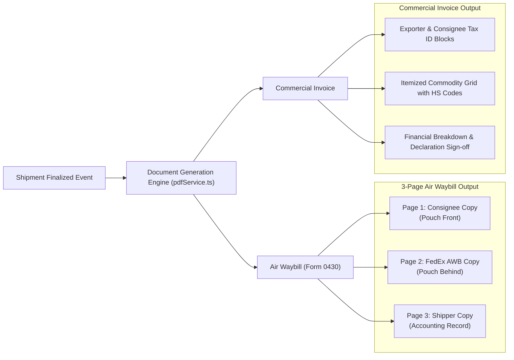
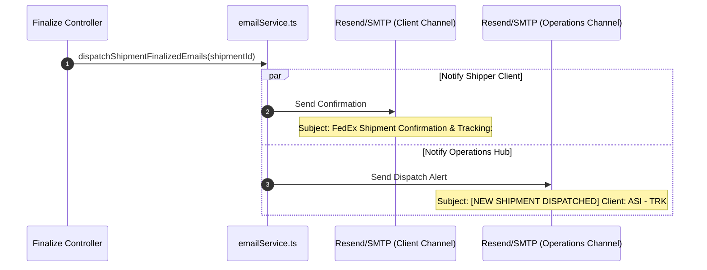
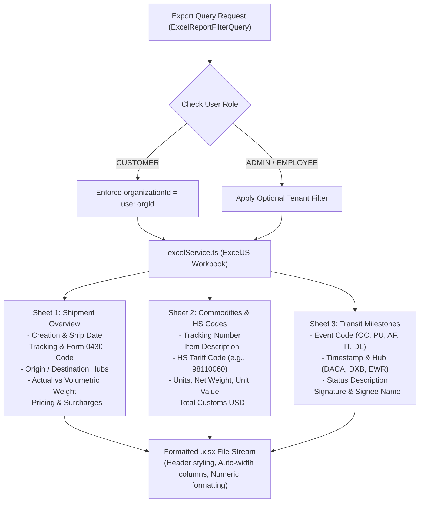

# FedEx Enterprise Replica — System Architecture Specification (`architecture.md`)

**Document Version:** 2.0.0  
**Phase:** 2 — Architecture & Design (`/replica-architect` & `/replica-design`)  
**Standard:** Enterprise Carrier Logistics SaaS (FedEx Ship Manager & Track REST API Parity)  
**TypeScript Compliance:** Strict mode (`strictNullChecks: true`, `noImplicitAny: true`, zero `any`)

---

## 1. Architectural Boundaries & Layering

The platform enforces a strict 4-layer separation of concerns. UI components remain entirely free of direct database or third-party logic, allowing individual services to scale or be extracted as standalone microservices if required:

### Layer Contracts:
- **Presentation Layer (`src/components/ui/`, `src/components/features/`)**: Stateless primitives styled purely through tokens in `design-tokens.json` mapped via `tailwind.config.ts`. Form components communicate exclusively via strongly-typed React hook controllers.
- **Application & Hook Layer (`src/hooks/`)**: Implements client-side state transitions, debounced rate calculations, optimistic UI updates, and local storage draft restoration.
- **Domain Service Layer (`src/services/`)**: Pure TypeScript business logic isolated from DOM dependencies. Every service has deterministic inputs, explicit return types, and isolated unit testability.
- **Data Persistence Layer (`src/lib/prisma.ts`, `prisma/schema.prisma`)**: Direct connection pooling through Neon PgBouncer with non-bypassable `organizationId` filtering on tenant operations.

---

## 2. Multi-Tenant Isolation Model (`organizationId` Enforcement)

To fulfill strict tenant privacy and support granular customer-specific reporting, every customer-generated record is bound to an `organizationId`.

### 2.1 Role-Based Access Control (RBAC) Matrix

| Resource / Action | ADMIN (Superuser) | EMPLOYEE (Staff - 3 Users) | CUSTOMER (Approved) | DRIVER (Courier) |
| :--- | :---: | :---: | :---: | :---: |
| **User KYC Approval / Rejection** | Full Access | Full Access | Denied | Denied |
| **Zone Matrix & Rate Configuration** | Full Access | Read-Only | Denied | Denied |
| **Shipment Creation / Finalization** | All Tenants | All Tenants | Own `organizationId` Only | Denied |
| **Air Waybill & Invoice Generation** | All Tenants | All Tenants | Own `organizationId` Only | Read-Only |
| **Scan Events & Proof of Delivery** | Full Access | Full Access | Read-Only (Own Shipments) | Assigned Routes |
| **Multi-Sheet Excel Reporting** | Global & Per-Tenant | Global & Per-Tenant | Own `organizationId` Only | Denied |
| **Audit Log Inspection** | Full Access | Read-Only | Denied | Denied |

---

## 3. The 7-Step FedEx Ship Manager State Pipeline

The shipment creation process faithfully replicates the production FedEx Ship Manager accordion pipeline, enforcing step-by-step validation:

### Detailed Section Validations:
1. **Step 1 — Ship From (Sender)**:
   - Verified against sender address book or new entry.
   - Requires Contact Name, Phone, Email, Address Line 1, City, Postal Code, Country Code (`BD` default), Origin Airport Code (`DACA`).
2. **Step 2 — Deliver To (Recipient)**:
   - Contact Name, Phone, Email, Street Address, City, Postal Code, Destination Country Code.
   - Automatic hub resolver maps destination country/city to standard IATA hub (e.g., `US` $\rightarrow$ `EWR`).
   - Residential flag toggles residential delivery fee surcharge.
3. **Step 3 — Package Details**:
   - Supports multi-package entry.
   - For each package: Length $\times$ Width $\times$ Height (cm or in) and Gross Weight (kg or lb).
   - Dynamic volumetric calculation: $\frac{L \times W \times H}{5000} \text{ kg}$.
   - Chargeable weight: $\max(W_{\text{actual}}, W_{\text{volumetric}})$.
4. **Step 4 — Package Contents & Customs**:
   - Classification: Documents Only vs. Commercial Commodities.
   - Line items: Description, HS Tariff Code (6 to 10 digits), Quantity, Unit of Measure (`PKS`, `PCS`, `KGS`, etc.), Unit Value (USD), Net Weight (kg).
   - Automated aggregation of Customs Declared Value.
5. **Step 5 — Service & Transit**:
   - Service Tiers: `INTERNATIONAL_PRIORITY`, `INTERNATIONAL_ECONOMY`, `INTERNATIONAL_FIRST`, `STANDARD_OVERNIGHT`, `PRIORITY_OVERNIGHT`, `GROUND_STANDARD`.
   - Signature Confirmation: `NO_SIGNATURE_REQUIRED`, `INDIRECT_SIGNATURE`, `DIRECT_SIGNATURE`, `ADULT_SIGNATURE`.
6. **Step 6 — Pickup / Drop-off Schedule**:
   - Toggle: Counter Drop-off vs. Scheduled Driver Pickup.
   - Ready time (e.g. `08:00 AM`) and latest pickup window (e.g. `01:30 PM`).
   - Special driver instructions and optional alternate pickup site.
7. **Step 7 — Billing & Dual Notification**:
   - Bill transportation to: `MY_ACCOUNT`, `RECIPIENT`, or `THIRD_PARTY`.
   - Customer reference (`referenceCode`), commercial invoice number (`invoiceNumber`), CAD number (`260504077/INET4535`).
   - Notification dispatch configurations for both Client and Company Operations.

---

## 4. Mod-11 12-Digit Tracking Number & Barcode Boundaries

### 4.1 Modulo-11 Check Digit Algorithm
FedEx 12-digit tracking numbers follow a weighted Mod-11 calculation:

$$\text{Tracking Number: } [d_1, d_2, d_3, d_4, d_5, d_6, d_7, d_8, d_9, d_{10}, d_{11}, c_{12}]$$

$$\text{Weights } W = [1, 3, 7, 1, 3, 7, 1, 3, 7, 1, 3]$$

$$\text{Sum} = \sum_{i=1}^{11} (d_i \times W[i-1])$$

$$\text{Remainder } R = \text{Sum} \pmod{11}$$

$$\text{Check Digit } c_{12} = \begin{cases} 0 & \text{if } R = 0 \text{ or } R = 10 \\ R & \text{otherwise} \end{cases}$$

### 4.2 Barcode Service Boundary (`barcodeService.ts`)
- **Linear Code 128 / GS1-128**: Rendered as crisp, resolution-independent SVG paths for direct printing on 203 DPI / 300 DPI thermal printers or standard laser printers.
- **Routing Data Header**: Encodes formatted routing string (e.g., `XA MTPA 58KJ1/70DF/484B`) with service acronym (`IP EOD`) and destination airport code (`EWR`).
- **Checksum Verification**: Provides `verifyTrackingNumber(tracking: string): boolean` for ingress scanning validation by driver devices.

---

## 5. Document Generation Pipeline (3-Page Air Waybill + Commercial Invoice)

### 5.1 Document Specifications:
- **Form Code**: `0430` (FedEx International Air Waybill Standard).
- **Page Dimensions**: ISO A4 / US Letter compliant print-ready layout with high-contrast monochrome ink specifications (`#000000`).
- **Rendering Technology**: Stream-based serverless PDF generation (`@react-pdf/renderer` or headless vector canvas) returning `application/pdf` streams with `Content-Disposition: inline`.

---

## 6. Dual-Email Dispatch Notification Triggers

When a shipment moves from `DRAFT_INCOMPLETE` to `SHIPMENT_CREATED_PRINTED`, the `emailService.ts` executes parallel asynchronous dispatches:

---

## 7. Multi-Sheet ExcelJS Export Architecture

The reporting engine provides deep, multi-worksheet Excel spreadsheets configured for customer audit, customs reconciliation, and internal logistics telemetry:

---

## 8. Summary of Engineering Invariants

1. **Zero `any` Policy**: Every function signature, hook state, and database response is statically typed.
2. **Single Source of Truth**: All domain statuses, codes, and units originate from `src/types/shipment.ts` and correspond 1:1 with `prisma/schema.prisma`.
3. **Print Precision**: All AWB vector barcodes and layout containers follow exact millimeter/point dimensions aligned with standard FedEx physical pouches.
4. **Fail-Safe Tenancy**: No database query for shipment or address book resources executes without an explicit `organizationId` parameter when invoked by a Customer session.
