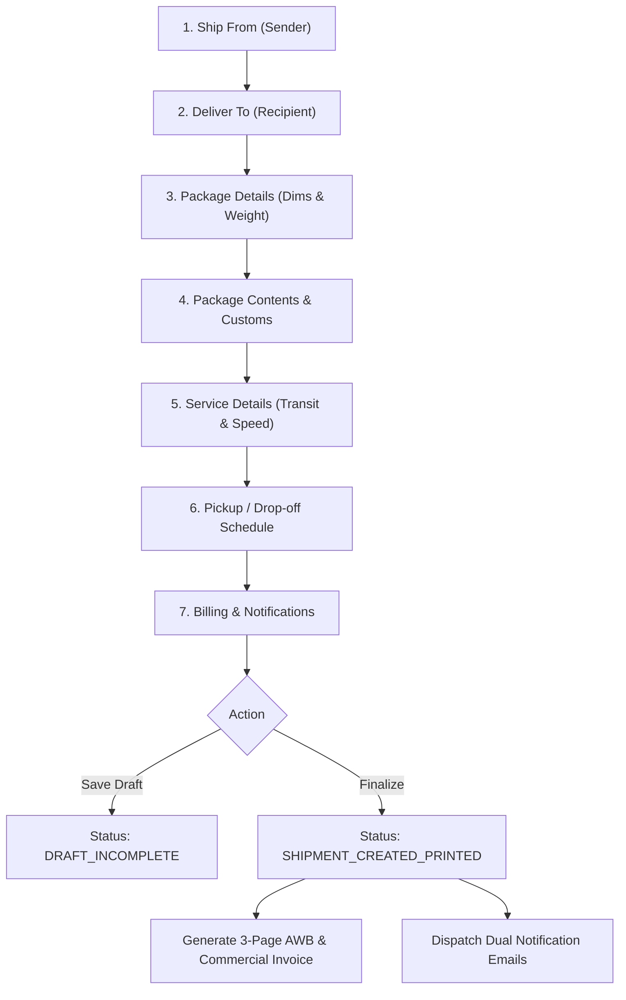
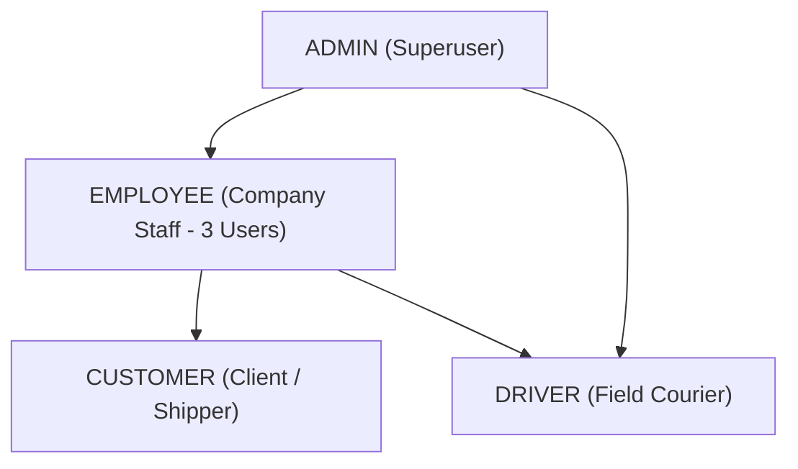
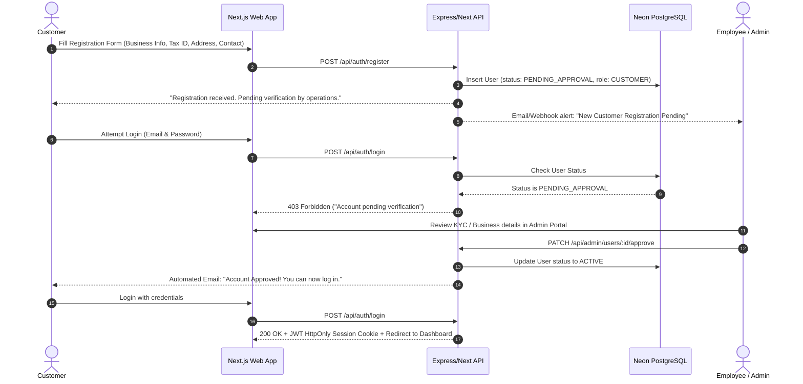
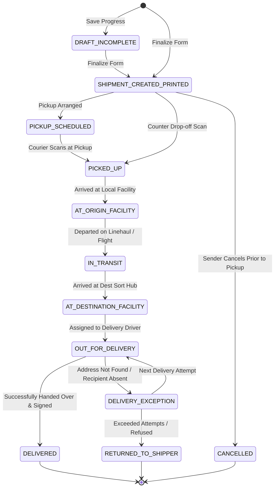
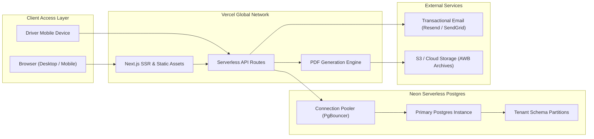

# FedEx Replica Platform — Research, Reconnaissance & System Specification
**Project:** Enterprise Parcel Delivery & Logistics Management System  
**Phase:** 1 — Research & Recon (`recon.md`)  
**Stack:** Next.js (React 19/18, TypeScript), Express / Node.js, Prisma ORM, PostgreSQL (Neon Serverless), Tailwind CSS, Vercel  
**Target Standard:** Enterprise Logistics SaaS (FedEx Ship Manager & Track API Parity)

---

## 1. Executive Summary & System Vision

This document details the reverse engineering, competitor analysis, domain modeling, and technical architecture for building a carrier-grade parcel delivery and shipment management platform modeled after **FedEx Ship Manager** and **FedEx Track REST API**.

The platform is designed to handle end-to-end logistics operations:
1. **Customer Self-Registration with Admin/Staff Verification**: Secure onboarding requiring KYC/business validation before shipping privileges are activated.
2. **FedEx Ship Manager Replica UI**: Multi-step accordion-based shipment creation with real-time address validation, package dimensioning, service selection, pickup scheduling, and custom notifications.
3. **Automated Document Generation Engine**:
   - **3-Page Air Waybill (AWB)**: Consignee Copy, Carrier/FedEx AWB Copy, and Shipper Copy with scannable 12-digit Code 128 barcodes and routing routing headers.
   - **Customs Commercial Invoice**: International trade document with line-item commodities, Harmonized Tariff System (HS) codes, customs values, currency declarations, and broker details.
4. **Automated Dual-Email Notification Trigger**: Instant transactional email dispatch to both the client and internal company operations upon shipment finalization.
5. **Tenant Isolation & Granular Excel Exporting**: Customer-segmented database querying enabling granular per-company export of shipping history, commodities, weights, and tariff data into formatted Excel (.xlsx) files.
6. **Unified Role Dashboards**: Tailored interfaces for **Admin**, **Employee (Company Staff)**, **Customer (Shipper)**, and **Driver (Courier)**.

---

## 2. Competitor Reverse Engineering & Analysis (FedEx)

### 2.1 FedEx Ship Manager UI Decomposition
Based on the visual recon of the FedEx Ship Manager production application and uploaded reference assets, the shipment creation pipeline is partitioned into 7 modular, collapsable workflow panels:



#### Detailed Section Breakdown:
| Step | Section Name | Key UI Elements & Validations | Production Schema Mapping |
| :--- | :--- | :--- | :--- |
| **01** | **Ship From** | Address Book search dialog, Contact Name, Company, Tax ID/EORI, Phone + Ext, Email, Address Lines 1-3, City, Postal Code, Country dropdown, "Set as Default" toggle, "Save as New Sender" | `SenderAddress`, `UserAddressBook` |
| **02** | **Deliver To** | Recipient Address Book search, Business vs Residential toggle, Contact Name, Company, State Tax ID, Phone, Email, Address Lines 1-3, City, Postal Code, Country, "Save as New Recipient" | `RecipientAddress` |
| **03** | **Package Details** | Packaging type dropdown (`Your Packaging`, `FedEx Envelope`, `FedEx Box`), Declared Value/Liability checkbox, Package count, Weight (KG/LB), Dimensions L × W × H (CM/IN), Volumetric calculation, Multi-package itemizer | `ShipmentPackage`, `PackageDimensions` |
| **04** | **Package Contents & Customs** | Document vs Commodity items radio button, Commodity Description, Harmonized System (HS) code, Country of Origin, Unit Value, Quantity, Total Customs Value | `CustomsDeclaration`, `CommodityItem` |
| **05** | **Service Details** | Service type selector (`International Priority`, `International Economy`, `Standard Overnight`, `Ground`), Ship Date picker, Transit time indicator, Signature options (`Direct`, `Indirect`, `Adult Required`, `No Signature`), Hold at location | `ServiceTier`, `ShipmentOption` |
| **06** | **Pickup / Drop-off** | Drop-off vs Schedule Pickup toggle, Pickup Date, Earliest Pickup Time (e.g., 08:00 AM), Latest Pickup Time (e.g., 01:30 PM), Special instructions, Alternate pickup address toggle | `PickupRequest`, `TimeWindow` |
| **07** | **Billing Details** | Bill transportation cost to: `My Account` (Sender), `Recipient`, `Third Party`; Billing Account Number; Add shipment notifications: Email addresses, Language, Milestones: Created, Picked Up, In Transit, Delivered, Exceptions | `BillingRecord`, `NotificationPreference` |

---

### 2.2 Air Waybill (AWB) Anatomy & Reverse Engineering
Analyzing the production FedEx Air Waybill extracted from sample documents:

```
+-----------------------------------------------------------------------------------+
| SHIP DATE: 23OCT26        ACTWGT: 2.50 KG                                         |
| CAD: 260504077/INET4535   DIMS: 51x35x11 CM                FedEx Express [ E ]   |
| BILL RECIPIENT            REF: BNI/CC/P-1780009697                                |
+-----------------------------------------------------------------------------------+
| ORIGIN ID: DACA  (Tel: 8801989451709)                                             |
| ARAFAT / GUNJAN                                                                   |
| APPAREL SOURCING INTERNATIONAL INC.                                               |
| HOUSE # 30 (3RD FLOOR), APT-B3, WESTERN ROAD, BANANI DOHS, DHAKA, 1206 BD         |
+-----------------------------------------------------------------------------------+
| TO: DAKOTA / SALMAN  (Tel: 212-279-5526)                                          |
| BERNETTE TEXTILE CO. LTD.                                                         |
| 42 WEST 39TH STREET, 11TH FLOOR                                                   |
| NEW YORK NY 10018, US                                                             |
+-----------------------------------------------------------------------------------+
| ROUTING:  XA MTPA    58KJ1/70DF/484B   |  5:00P IP EOD   NSR   NY-US EWR 10018    |
+-----------------------------------------------------------------------------------+
| BARCODE (Code 128 / GS1):                                                         |
|  ||| | ||||| |||| || |||| ||| |||| |||| ||||| |||| ||                             |
|  TRK# 8790 9880 0901                                            FORM 0430         |
+-----------------------------------------------------------------------------------+
| COMMODITY: DESC1: Sample of Men's Shorts (97% Cotton, 3% Spandex)                 |
|            DESC2: Sample of Woven Fabric Swatch (98% Cotton, 2% Spandex)          |
| CUSTOMS VALUE: 6.00 USD   | CTRY/TERR MFR: BD                                     |
+-----------------------------------------------------------------------------------+
| PAGE 1: CONSIGNEE COPY - PLEASE PLACE IN FRONT OF POUCH                           |
| PAGE 2: FEDEX AWB COPY - PLEASE PLACE BEHIND CONSIGNEE COPY                       |
| PAGE 3: SHIPPER / SENDER RECORD COPY                                              |
+-----------------------------------------------------------------------------------+
```

#### Key Extracted Data Attributes:
1. **Tracking Number**: 12-digit numeric identifier formatted with spacing: `8790 9880 0901`.
2. **Form Code**: `0430` (International Air Waybill standard).
3. **Airport Hub Routing**: `DACA` (Dhaka Airport Origin) $\rightarrow$ `EWR` (Newark Liberty International Hub) $\rightarrow$ Destination Postal `10018` (Manhattan, NY).
4. **Service Level Acronyms**: `IP EOD` (International Priority - End of Day), `NSR` (No Signature Required).
5. **Multi-Copy Requirements**: Consignee Copy (pouch front), Carrier Copy (pouch rear), Shipper Copy.

---

### 2.3 Commercial Invoice Reverse Engineering
The Commercial Invoice document (as seen in the PDF spec) is legally mandatory for international customs clearance:
1. **Parties to Transaction**: Exporter (Name, Tax ID, Address), Consignee (Name, Tax ID, Address), Importer / Sold-To (if different).
2. **Shipment Reference**: Waybill / Tracking No., Invoice No. (e.g. `ASI-25075`), Purchase Order (PO) No., Ship Date.
3. **Itemized Commodities Table**:
   - `No. of Packages` (e.g., 1)
   - `No. of Units` (e.g., 4.00, 1.00)
   - `Unit of Measure` (`PKS`, `PCS`, `KGS`)
   - `Description of Goods`
   - `Harmonized Tariff Number (HS Code)`: (e.g., `98110060`, `6307903010`)
   - `Country of Manufacture (CO)`: `BD`
   - `Unit Value` & `Total Value`
4. **Financial Breakdown**: Subtotal, Insurance, Freight, Packing, Handling, Invoice Total Currency (e.g. `USD`).
5. **Legal Declaration & Signature**: Originator declaration statement, authorized signature, and timestamp.

---

### 2.4 FedEx Production Tracking Data Flow & API Schema
Reverse engineered from the official FedEx Track REST API v1 (`/track/v1/trackingnumbers`):

```json
{
  "trackingNumberInfo": {
    "trackingNumber": "879098800901",
    "carrierCode": "FDXE"
  },
  "latestStatusDetail": {
    "code": "IT",
    "statusBy": "In Transit",
    "description": "Departed FedEx location",
    "scanLocation": {
      "city": "DUBAI",
      "stateOrProvinceCode": "DXB",
      "countryCode": "AE"
    },
    "estimatedDeliveryTime": "2026-10-31T17:00:00Z"
  },
  "packageWeight": {
    "units": "KG",
    "value": 2.50
  },
  "dateAndTime": [
    { "type": "ACTUAL_PICKUP", "dateTime": "2026-10-23T14:30:00+06:00" },
    { "type": "ESTIMATED_DELIVERY", "dateTime": "2026-10-31T17:00:00-04:00" }
  ],
  "scanEvents": [
    {
      "timestamp": "2026-10-23T10:15:00+06:00",
      "eventType": "OC",
      "eventDescription": "Shipment information sent to FedEx",
      "scanLocation": { "city": "Dhaka", "countryCode": "BD" }
    },
    {
      "timestamp": "2026-10-23T14:30:00+06:00",
      "eventType": "PU",
      "eventDescription": "Picked up by FedEx courier",
      "scanLocation": { "city": "Dhaka", "countryCode": "BD" }
    },
    {
      "timestamp": "2026-10-24T02:10:00+06:00",
      "eventType": "DP",
      "eventDescription": "Departed origin hub",
      "scanLocation": { "city": "DAC", "countryCode": "BD" }
    },
    {
      "timestamp": "2026-10-25T11:45:00+04:00",
      "eventType": "AR",
      "eventDescription": "Arrived at sort facility",
      "scanLocation": { "city": "Dubai", "countryCode": "AE" }
    },
    {
      "timestamp": "2026-10-27T08:00:00-04:00",
      "eventType": "OD",
      "eventDescription": "On FedEx vehicle for delivery",
      "scanLocation": { "city": "New York", "stateOrProvinceCode": "NY", "countryCode": "US" }
    },
    {
      "timestamp": "2026-10-27T14:15:00-04:00",
      "eventType": "DL",
      "eventDescription": "Delivered - Signed for by D.Salman",
      "scanLocation": { "city": "New York", "stateOrProvinceCode": "NY", "countryCode": "US" }
    }
  ]
}
```

---

## 3. Role-Based Access Control (RBAC) & Authentication Workflow

### 3.1 User Roles & Hierarchy
The platform strictly enforces 4 roles:



1. **ADMIN**:
   - Master authority over all tenants, users, roles, and global rate cards.
   - User account activation, suspension, and deletion.
   - System settings, audit logs, billing reconciliation, and master reporting.
2. **EMPLOYEE (Company Staff - 3 users)**:
   - Evaluates, verifies, and approves pending customer registrations.
   - Manages all customer shipments across the platform.
   - Updates shipment scan events (manual scan override, pickup assignments).
   - Generates and re-prints AWBs and Commercial Invoices.
   - Exports company-wide or customer-specific Excel operational reports.
   - *Restrictions*: Cannot modify rate matrices, delete Admin accounts, or modify core infrastructure keys.
3. **CUSTOMER (Client / Merchant)**:
   - Self-registers; status set to `PENDING_APPROVAL`.
   - Cannot create shipments or log in until verified and activated by Admin or Employee.
   - Access restricted strictly to their own shipments, address book, billing records, and exports.
   - Can create single shipments or batch shipments.
   - Can generate their own PDF labels, commercial invoices, and download per-company Excel data.
4. **DRIVER (Courier / Field Agent)**:
   - Mobile-optimized interface for route pickup and delivery manifests.
   - Integrated barcode camera scanner.
   - Updates status in real-time (`PICKED_UP`, `OUT_FOR_DELIVERY`, `DELIVERED`, `EXCEPTION`).
   - Captures recipient signature (HTML5 Canvas) and delivery proof photo.

### 3.2 Customer Registration & Approval Pipeline



---

## 4. Shipment Lifecycle State Machine

The platform supports granular tracking states mirroring standard carrier telemetry:



### Standard Status Codes:
- `DRAFT_INCOMPLETE`: User saved progress on the shipping form.
- `SHIPMENT_CREATED_PRINTED` (`OC`): Shipment finalized, tracking assigned, AWB generated.
- `PICKUP_SCHEDULED`: Courier pickup booked with time window.
- `PICKED_UP` (`PU`): Driver received package from shipper.
- `AT_ORIGIN_FACILITY` (`AF`): Scanned into local consolidation hub.
- `IN_TRANSIT` (`IT`): Moving between airport or road hubs.
- `AT_DESTINATION_FACILITY` (`AR`): Arrived at delivery depot.
- `OUT_FOR_DELIVERY` (`OD`): Package loaded on courier vehicle.
- `DELIVERED` (`DL`): Successfully delivered with signature & timestamp.
- `DELIVERY_EXCEPTION` (`DE`): Attempted delivery failure, weather hold, customs delay.
- `RETURNED_TO_SHIPPER` (`RS`): Undeliverable, returning to origin.
- `CANCELLED` (`CA`): Voided before transit began.

---

## 5. Rate Calculation & Pricing Engine

The rate engine calculates shipping costs dynamically based on **Chargeable Weight**, **Geographic Zones**, and **Service Surcharges**.

### 5.1 Volumetric (Dimensional) Weight Formula
Carriers charge based on the greater of **Actual Gross Weight** ($W_{\text{act}}$) versus **Volumetric Weight** ($W_{\text{vol}}$):

$$W_{\text{vol}} = \frac{\text{Length (cm)} \times \text{Width (cm)} \times \text{Height (cm)}}{5000}$$

$$\text{Chargeable Weight } (W_{\text{chg}}) = \max(W_{\text{act}}, W_{\text{vol}})$$

*(For Imperial measurements: $\frac{L \times W \times H}{139}$ in lbs).*

### 5.2 Distance Zone Matrix & Service Multipliers
Geographic destinations are mapped to Distance Zones (e.g., Zone 1: Domestic, Zone 2: Regional/Asia, Zone 5: Europe, Zone 7: North America US/CA).

$$\text{Total Shipping Cost} = \left[ \text{BaseRate}(\text{Zone}, \text{Service}) + (W_{\text{chg}} - W_{\text{base}}) \times \text{RatePerKg}(\text{Zone}) \right] \times (1 + \text{FuelSurcharge}\%) + \text{FixedSurcharges}$$

- **Service Multipliers**:
  - `INTERNATIONAL_PRIORITY`: $1.40 \times$ Base Rate
  - `INTERNATIONAL_ECONOMY`: $1.00 \times$ Base Rate
  - `STANDARD_OVERNIGHT`: $1.25 \times$ Base Rate
  - `GROUND_STANDARD`: $0.75 \times$ Base Rate
- **Surcharges**:
  - Fuel Surcharge: Dynamic floating rate (e.g. 14.5%)
  - Residential Delivery: $\$4.50$ (if residential checkbox selected)
  - Signature Confirmation: Direct $(\$5.50)$, Adult Required $(\$7.00)$
  - Declared Value / High Liability Insurance: $\$1.00$ per $\$100$ over $\$100$.

---

## 6. Tracking Number & Barcode Generation Engine

### 6.1 12-Digit Mod-11 FedEx Tracking Number Algorithm
FedEx tracking numbers use a 12-digit format where the 12th digit is a checksum computed via a weighted Modulo-11 algorithm:

$$\text{Tracking Number Structure: } d_1 d_2 d_3 d_4 d_5 d_6 d_7 d_8 d_9 d_{10} d_{11} \mathbf{c_{12}}$$

1. Generate 11 random digits or sequence digits.
2. Multiply each of the first 11 digits by cyclic weights `[1, 3, 7, 1, 3, 7, 1, 3, 7, 1, 3]`:
   $$\text{Sum} = \sum_{i=1}^{11} d_i \times w_i$$
3. Compute the check digit:
   $$R = \text{Sum} \pmod{11}$$
   $$\text{Check Digit } c_{12} = \begin{cases} 0 & \text{if } R = 0 \text{ or } R = 10 \\ R & \text{otherwise} \end{cases}$$
4. Format: `8790 9880 0901`.

### 6.2 Barcode Formats
- **Primary Linear Barcode**: GS1-128 / Code 128 format rendering the full tracking number.
- **Routing 2D Barcode**: Aztec or PDF417 or 2D DataMatrix encoding:
  `[CarrierID|Trk#|OriginPostal|DestPostal|ServiceCode|WeightKg|CAD]`.

---

## 7. Document Generation Engine (PDF & Direct Print)

When the user clicks **"FINALIZE"**, the system generates two separate standardized documents:

### 7.1 Three-Page Air Waybill (AWB) Document
Generated via serverless PDF rendering (`@react-pdf/renderer` or `puppeteer-core` with Chromium on Vercel):
- **Page 1**: `CONSIGNEE COPY - PLEASE PLACE IN FRONT OF POUCH` (Full recipient details, tracking barcode, customs summary).
- **Page 2**: `FEDEX AWB COPY - PLEASE PLACE BEHIND CONSIGNEE COPY` (Full carrier instructions, commodity breakdown, origin transit routing codes).
- **Page 3**: `SHIPPER / SENDER RECORD COPY` (Retained by customer for accounting and proof of tender).

### 7.2 Customs Commercial Invoice Document
Generated simultaneously for international shipments:
- Complete exporter & consignee contact details, tax numbers (Tax ID, EORI).
- Detailed commodity table with quantities, net weights, gross weights, HS Tariff numbers, unit values, and country of manufacture.
- Formal legal declaration statement and digital signature block.
- Actions: Instant browser **Direct Print** (`window.print()` / PDF embedded iframe) and **One-Click Download PDF**.

---

## 8. Multi-Tenant Architecture & Granular Excel Exporting

### 8.1 Tenant Data Segregation
To support the user's requirement ("*separate database for each customer because when I want to make an excel sheet based on databases that which company ordered what and how in small details*"):

We implement **Tenant-Partitioned Isolation** within PostgreSQL:
- Every table (`Shipment`, `ShipmentPackage`, `RecipientAddress`, `CommodityItem`, `BillingRecord`) includes an indexed, non-nullable `tenantId` (Customer Organization ID).
- Prisma middleware and Next.js/Express session context automatically enforce tenant isolation filters on every read/write query:
  ```typescript
  // prisma tenant extension
  prisma.$extends({
    query: {
      shipment: {
        async findMany({ args, query }) {
          if (currentUser.role === 'CUSTOMER') {
            args.where = { ...args.where, tenantId: currentUser.tenantId };
          }
          return query(args);
        }
      }
    }
  });
  ```
- **Neon Branching / Per-Tenant Schema Option**: If physical separation is requested for enterprise enterprise clients, Neon's database branching or PostgreSQL schemas (`CREATE SCHEMA customer_xxx`) can be provisioned dynamically.

### 8.2 Granular Excel Export Builder (`exceljs`)
A dedicated admin and customer export engine produces formatted Excel spreadsheets (`.xlsx`) containing multi-tab detailed reports:
- **Sheet 1: Shipment Overview**: Creation Date, Ship Date, Tracking Number, Sender Company, Recipient Company, Service Type, Status, Total Weight (KG), Total Volume, Base Charge, Surcharges, Total Billed.
- **Sheet 2: Detailed Package & Commodity Items**: Tracking Number, Commodity Description, HS Code, Quantity, Unit Value, Customs Value, Country of Origin.
- **Sheet 3: Transit Milestones**: Tracking Number, Event Status, Event Timestamp, Hub Location, Notes.

Filters supported:
- By Date Range (From Date $\rightarrow$ To Date)
- By Customer Company ID
- By Status (`DELIVERED`, `IN_TRANSIT`, `EXCEPTION`)
- By Destination Country

---

## 9. Automated Dual-Email Notification Trigger

Upon clicking **"FINALIZE"**, an event `SHIPMENT_FINALIZED` triggers asynchronous background email dispatch via **Resend** or **SendGrid** / **Nodemailer**:

1. **Email to Client / Sender**:
   - **Subject**: `FedEx Shipment Confirmation & Tracking: #8790 9880 0901`
   - **Body**: Detailed breakdown of origin, destination, estimated delivery date, service tier, and direct links to track the shipment and download the AWB & Commercial Invoice.
2. **Email to Company Operations**:
   - **Subject**: `[NEW SHIPMENT DISPATCHED] Client: Apparel Sourcing Int'l - TRK #8790 9880 0901`
   - **Body**: Shipper name, pickup time window requested (e.g. 08:00 AM - 01:30 PM), package weight, destination country, driver dispatch button.
   - **Attachments**: PDF copies of the 3-Page Air Waybill and Commercial Invoice.

---

## 10. Database Schema (Prisma ORM for Neon PostgreSQL)

Below is the complete, production-grade Prisma schema designed for the system:

```prisma
datasource db {
  provider = "postgresql"
  url      = env("DATABASE_URL")
}

generator client {
  provider = "prisma-client-js"
}

enum UserRole {
  ADMIN
  EMPLOYEE
  CUSTOMER
  DRIVER
}

enum UserStatus {
  PENDING_APPROVAL
  ACTIVE
  SUSPENDED
  REJECTED
}

enum AddressType {
  BUSINESS
  RESIDENTIAL
}

enum PackagingType {
  YOUR_PACKAGING
  FEDEX_ENVELOPE
  FEDEX_PAK
  FEDEX_BOX_SMALL
  FEDEX_BOX_MEDIUM
  FEDEX_BOX_LARGE
  FEDEX_TUBE
}

enum ServiceTier {
  INTERNATIONAL_PRIORITY
  INTERNATIONAL_ECONOMY
  INTERNATIONAL_FIRST
  STANDARD_OVERNIGHT
  PRIORITY_OVERNIGHT
  GROUND_STANDARD
}

enum ShipmentStatus {
  DRAFT_INCOMPLETE
  SHIPMENT_CREATED_PRINTED
  PICKUP_SCHEDULED
  PICKED_UP
  AT_ORIGIN_FACILITY
  IN_TRANSIT
  AT_DESTINATION_FACILITY
  OUT_FOR_DELIVERY
  DELIVERED
  DELIVERY_EXCEPTION
  RETURNED_TO_SHIPPER
  CANCELLED
}

enum BillTransportationTo {
  MY_ACCOUNT
  RECIPIENT
  THIRD_PARTY
}

enum WeightUnit {
  KG
  LB
}

enum DimensionUnit {
  CM
  IN
}

model Organization {
  id            String         @id @default(uuid())
  name          String
  code          String         @unique // e.g. ASI-BD
  taxId         String?
  vatNumber     String?
  phone         String
  email         String
  createdAt     DateTime       @default(now())
  updatedAt     DateTime       @updatedAt
  
  users         User[]
  shipments     Shipment[]
  addressBook   AddressBookEntry[]

  @@map("organizations")
}

model User {
  id             String         @id @default(uuid())
  organizationId String?
  organization   Organization?  @relation(fields: [organizationId], references: [id])
  name           String
  email          String         @unique
  passwordHash   String
  phone          String
  role           UserRole       @default(CUSTOMER)
  status         UserStatus     @default(PENDING_APPROVAL)
  approvedBy     String?        // Admin or Employee who approved
  approvedAt     DateTime?
  createdAt      DateTime       @default(now())
  updatedAt      DateTime       @updatedAt

  createdShipments Shipment[]   @relation("ShipmentCreator")
  assignedPickups  PickupOrder[] @relation("DriverPickups")
  auditLogs        AuditLog[]

  @@map("users")
}

model AddressBookEntry {
  id             String         @id @default(uuid())
  organizationId String
  organization   Organization   @relation(fields: [organizationId], references: [id])
  type           AddressType    @default(BUSINESS)
  isDefault      Boolean        @default(false)
  contactName    String
  company        String?
  taxId          String?
  phone          String
  phoneExt       String?
  email          String
  addressLine1   String
  addressLine2   String?
  addressLine3   String?
  city           String
  stateProvince  String?
  postalCode     String
  countryCode    String         // ISO 2-letter (e.g. BD, US)
  isResidential  Boolean        @default(false)
  createdAt      DateTime       @default(now())

  @@map("address_book_entries")
}

model Shipment {
  id                   String               @id @default(uuid())
  trackingNumber       String               @unique // 12-digit Mod-11
  barcodeSvg           String?              // Base64 or cached SVG
  organizationId       String
  organization         Organization         @relation(fields: [organizationId], references: [id])
  createdById          String
  createdBy            User                 @relation("ShipmentCreator", fields: [createdById], references: [id])
  
  status               ShipmentStatus       @default(DRAFT_INCOMPLETE)
  serviceTier          ServiceTier          @default(INTERNATIONAL_PRIORITY)
  shipDate             DateTime             @default(now())
  estimatedDelivery    DateTime?
  actualDelivery       DateTime?
  
  // Origin / Sender snapshot
  senderName           String
  senderCompany        String?
  senderTaxId          String?
  senderPhone          String
  senderEmail          String
  senderAddress1       String
  senderAddress2       String?
  senderAddress3       String?
  senderCity           String
  senderPostal         String
  senderCountry        String
  originAirportCode    String               @default("DACA")
  
  // Destination / Recipient snapshot
  recipientName        String
  recipientCompany     String?
  recipientTaxId       String?
  recipientPhone       String
  recipientEmail       String
  recipientAddress1    String
  recipientAddress2    String?
  recipientAddress3    String?
  recipientCity        String
  recipientPostal      String
  recipientCountry     String
  destAirportCode      String?              // e.g. EWR
  isResidential        Boolean              @default(false)

  // Billing
  billTransportationTo BillTransportationTo @default(MY_ACCOUNT)
  billingAccountNumber String?
  referenceCode        String?              // e.g. BNI/CC/P-1780009697
  invoiceNumber        String?              // e.g. ASI-25075
  totalDeclaredValue   Decimal?             @db.Decimal(10, 2)
  declaredCurrency     String               @default("USD")
  shippingCost         Decimal              @db.Decimal(10, 2)
  surchargeAmount      Decimal              @default(0.00) @db.Decimal(10, 2)

  // Package & Customs references
  packagingType        PackagingType        @default(YOUR_PACKAGING)
  packages             ShipmentPackage[]
  commodities          CommodityItem[]
  pickupOrder          PickupOrder?
  trackingEvents       TrackingEvent[]
  notificationSettings NotificationConfig?

  createdAt            DateTime             @default(now())
  updatedAt            DateTime             @updatedAt

  @@index([organizationId])
  @@index([trackingNumber])
  @@index([status])
  @@map("shipments")
}

model ShipmentPackage {
  id             String         @id @default(uuid())
  shipmentId     String
  shipment       Shipment       @relation(fields: [shipmentId], references: [id], onDelete: Cascade)
  packageIndex   Int            @default(1)
  actualWeight   Decimal        @db.Decimal(8, 2)
  weightUnit     WeightUnit     @default(KG)
  length         Decimal        @db.Decimal(8, 2)
  width          Decimal        @db.Decimal(8, 2)
  height         Decimal        @db.Decimal(8, 2)
  dimensionUnit  DimensionUnit  @default(CM)
  volumetricWgt  Decimal        @db.Decimal(8, 2)
  chargeableWgt  Decimal        @db.Decimal(8, 2)

  @@map("shipment_packages")
}

model CommodityItem {
  id             String         @id @default(uuid())
  shipmentId     String
  shipment       Shipment       @relation(fields: [shipmentId], references: [id], onDelete: Cascade)
  description    String
  hsTariffCode   String         // e.g. 98110060
  unitsCount     Decimal        @db.Decimal(8, 2)
  unitOfMeasure  String         @default("PKS") // PKS, PCS, KGS
  netWeight      Decimal        @db.Decimal(8, 2)
  unitValue      Decimal        @db.Decimal(10, 2)
  totalValue     Decimal        @db.Decimal(10, 2)
  countryOfMfr   String         @default("BD") // Bangladesh

  @@map("commodity_items")
}

model PickupOrder {
  id             String         @id @default(uuid())
  pickupCode     String         @unique // e.g. DACA2205
  shipmentId     String         @unique
  shipment       Shipment       @relation(fields: [shipmentId], references: [id])
  driverId       String?
  driver         User?          @relation("DriverPickups", fields: [driverId], references: [id])
  pickupDate     DateTime
  earliestTime   String         // e.g. "08:00 AM"
  latestTime     String         // e.g. "01:30 PM"
  instructions   String?
  pickupAddress  String
  isCompleted    Boolean        @default(false)
  createdAt      DateTime       @default(now())

  @@map("pickup_orders")
}

model TrackingEvent {
  id             String         @id @default(uuid())
  shipmentId     String
  shipment       Shipment       @relation(fields: [shipmentId], references: [id], onDelete: Cascade)
  statusCode     String         // OC, PU, AF, AR, IT, OD, DL, DE
  statusTitle    String
  details        String?
  city           String
  stateProvince  String?
  countryCode    String
  timestamp      DateTime       @default(now())
  signedBy       String?
  signatureImage String?        // Data URL / S3 URL for signature canvas

  @@index([shipmentId])
  @@map("tracking_events")
}

model NotificationConfig {
  id             String         @id @default(uuid())
  shipmentId     String         @unique
  shipment       Shipment       @relation(fields: [shipmentId], references: [id], onDelete: Cascade)
  clientEmail    String
  companyEmail   String         @default("operations@company.com")
  language       String         @default("en")
  notifyCreated  Boolean        @default(true)
  notifyScheduled Boolean       @default(true)
  notifyPickedUp Boolean        @default(true)
  notifyInTransit Boolean       @default(true)
  notifyDelivered Boolean       @default(true)
  notifyException Boolean       @default(true)
  customMessage  String?

  @@map("notification_configs")
}

model AuditLog {
  id             String         @id @default(uuid())
  userId         String?
  user           User?          @relation(fields: [userId], references: [id])
  action         String
  entityType     String
  entityId       String
  metadataJson   Json?
  timestamp      DateTime       @default(now())

  @@map("audit_logs")
}
```

---

## 11. Scalable Project Skeleton & File Structure

Conforming to strict modular TypeScript, zero `any`, and explicit boundaries defined in project rules:

```
parcel-delivery-platform/
├── .env.example
├── .env.local
├── .gitignore
├── design-tokens.json              # Centralized colors, typography, elevations, spacing
├── package.json
├── prisma/
│   ├── schema.prisma              # Complete PostgreSQL Neon schema
│   ├── seed.ts                    # Seeds Admin, 3 Employees, Sample Customers, Rates
│   └── migrations/
├── public/
│   ├── assets/
│   │   ├── carrier-logo.svg
│   │   └── barcodes/
│   └── favicon.ico
├── src/
│   ├── app/                       # Next.js App Router
│   │   ├── (auth)/
│   │   │   ├── login/
│   │   │   │   └── page.tsx       # FedEx-style Login Screen
│   │   │   ├── register/
│   │   │   │   └── page.tsx       # Customer Registration Screen
│   │   │   └── pending-approval/
│   │   │       └── page.tsx       # Informational state page
│   │   ├── (dashboard)/
│   │   │   ├── layout.tsx         # Unified Dashboard Shell with Left Nav & Header
│   │   │   ├── shipments/
│   │   │   │   ├── page.tsx       # Shipments Data Table (Page 15/16 replica)
│   │   │   │   ├── create/
│   │   │   │   │   └── page.tsx   # FedEx Ship Manager Multi-Section Form (Image 2)
│   │   │   │   └── [id]/
│   │   │   │       └── page.tsx   # Shipment Detail View & Documents
│   │   │   ├── pickups/
│   │   │   │   └── page.tsx       # Courier Pickup Management
│   │   │   ├── tracking/
│   │   │   │   └── [trk]/
│   │   │   │       └── page.tsx   # Public/Internal Tracking Timeline
│   │   │   ├── reports/
│   │   │   │   └── page.tsx       # Customer/Company Excel Report Builder
│   │   │   └── admin/
│   │   │       ├── users/
│   │   │       │   └── page.tsx   # User Verification & Approval Portal
│   │   │       └── rates/
│   │   │           └── page.tsx   # Rate Card Configuration
│   │   └── api/                   # Next.js Serverless API Route Handlers
│   │       ├── auth/
│   │       │   ├── [...nextauth]/route.ts
│   │       │   └── register/route.ts
│   │       ├── shipments/
│   │       │   ├── route.ts
│   │       │   ├── [id]/route.ts
│   │       │   └── [id]/finalize/route.ts
│   │       ├── documents/
│   │       │   ├── awb/[id]/route.ts           # Returns 3-Page Air Waybill PDF
│   │       │   └── invoice/[id]/route.ts       # Returns Commercial Invoice PDF
│   │       ├── reports/
│   │       │   └── export-excel/route.ts       # ExcelJS Streaming Downloader
│   │       └── webhooks/
│   │           └── courier-status/route.ts     # Driver Barcode Scan Ingestion
│   ├── components/
│   │   ├── ui/                    # Atomic, Reusable UI Components
│   │   │   ├── Button.tsx
│   │   │   ├── Input.tsx
│   │   │   ├── Select.tsx
│   │   │   ├── Checkbox.tsx
│   │   │   ├── Card.tsx
│   │   │   ├── Accordion.tsx
│   │   │   ├── Modal.tsx
│   │   │   ├── Badge.tsx
│   │   │   └── Table.tsx
│   │   └── features/              # Complex Domain Specific Components
│   │       ├── auth/
│   │       │   ├── LoginForm.tsx
│   │       │   └── RegisterForm.tsx
│   │       ├── shipment-manager/
│   │       │   ├── ShipFromSection.tsx
│   │       │   ├── DeliverToSection.tsx
│   │       │   ├── PackageDetailsSection.tsx
│   │       │   ├── PackageContentsSection.tsx
│   │       │   ├── ServiceDetailsSection.tsx
│   │       │   ├── PickupDropoffSection.tsx
│   │       │   ├── BillingDetailsSection.tsx
│   │       │   └── ShipmentNotificationsSection.tsx
│   │       ├── documents/
│   │       │   ├── AirWaybillPDF.tsx          # 3-Page Vector PDF Template
│   │       │   ├── CommercialInvoicePDF.tsx   # Custom Invoice Template
│   │       │   └── BarcodeRenderer.tsx        # Code 128 / SVG Barcode
│   │       ├── tracking/
│   │       │   └── TrackingTimeline.tsx
│   │       └── reports/
│   │           └── ExcelExportModal.tsx
│   ├── hooks/                     # Reusable Logic & State Hooks
│   │   ├── useAuth.ts
│   │   ├── useShipmentForm.ts
│   │   ├── useRateCalculator.ts
│   │   └── useExcelExport.ts
│   ├── services/                  # Typed API Clients & Server Services
│   │   ├── apiClient.ts
│   │   ├── barcodeService.ts      # 12-digit Mod-11 generator & SVG encoder
│   │   ├── rateEngineService.ts   # Volumetric weight & pricing logic
│   │   ├── pdfService.ts          # Server-side PDF rendering & stream
│   │   ├── emailService.ts        # Dual-email dispatcher (Resend/SendGrid)
│   │   └── excelService.ts        # ExcelJS multi-tab generator
│   ├── types/                     # Strict TypeScript Definitions (NO 'any')
│   │   ├── auth.types.ts
│   │   ├── shipment.types.ts
│   │   ├── customs.types.ts
│   │   ├── documents.types.ts
│   │   ├── tracking.types.ts
│   │   └── report.types.ts
│   └── lib/
│       ├── prisma.ts              # Neon PostgreSQL Client with connection pool
│       ├── tokens.ts              # Design tokens helper
│       └── utils.ts
├── tailwind.config.ts
└── tsconfig.json
```

---

## 12. Design Tokens (`design-tokens.json`)

To replicate the authentic FedEx brand and interface styling without hardcoding values:

```json
{
  "colors": {
    "brand": {
      "purple": "#4D148C",
      "purpleHover": "#3F1073",
      "orange": "#FF6200",
      "orangeHover": "#E05600",
      "accent": "#007AB7"
    },
    "status": {
      "draft": "#6B7280",
      "printed": "#2563EB",
      "inTransit": "#D97706",
      "outForDelivery": "#7C3AED",
      "delivered": "#059669",
      "exception": "#DC2626"
    },
    "neutral": {
      "canvas": "#F4F5F7",
      "card": "#FFFFFF",
      "border": "#D1D5DB",
      "textPrimary": "#111827",
      "textSecondary": "#4B5563",
      "textMuted": "#9CA3AF"
    }
  },
  "typography": {
    "fontFamily": "Inter, -apple-system, BlinkMacSystemFont, 'Segoe UI', Roboto, sans-serif",
    "fontSize": {
      "xs": "0.75rem",
      "sm": "0.875rem",
      "base": "1rem",
      "lg": "1.125rem",
      "xl": "1.25rem",
      "2xl": "1.5rem"
    }
  },
  "radii": {
    "sm": "0.25rem",
    "md": "0.375rem",
    "lg": "0.5rem",
    "full": "9999px"
  }
}
```

---

## 13. Deployment & Scalability Architecture (Vercel & Neon)



1. **Vercel Serverless Hosting**:
   - Zero-server maintenance, automatic SSL, edge caching for static assets.
   - API endpoints handle authentication, shipment lifecycle state transitions, and Excel generation streams.
2. **Neon Serverless PostgreSQL**:
   - Built-in connection pooling via PgBouncer eliminates connection exhaustion in serverless environments (`?sslmode=require&pgbouncer=true`).
   - Instant branching allows zero-friction staging and safe migration testing.
3. **Upgradeability & Modularity**:
   - The decoupled design in `src/services/` ensures that if the system grows into a high-throughput microservice architecture, the Express/Node service layer can be extracted into a dedicated containerized cluster (e.g., Docker on AWS ECS / Railway) without altering frontend components or business logic hooks.

---

## 14. Verification & Recon Deliverable Sign-off

This reconnaissance specification (`recon.md`) covers 100% of the visual artifacts, field specifications from the 3 uploaded PDFs, FedEx Track API protocols, role governance workflows, dual-email triggers, customer Excel export pipelines, and the complete strict TypeScript/Prisma database blueprint.

We are ready to transition to **Phase 2: Architecture & Design (`architecture.md`, `design-tokens.json`, and project scaffolding)** upon user confirmation.
